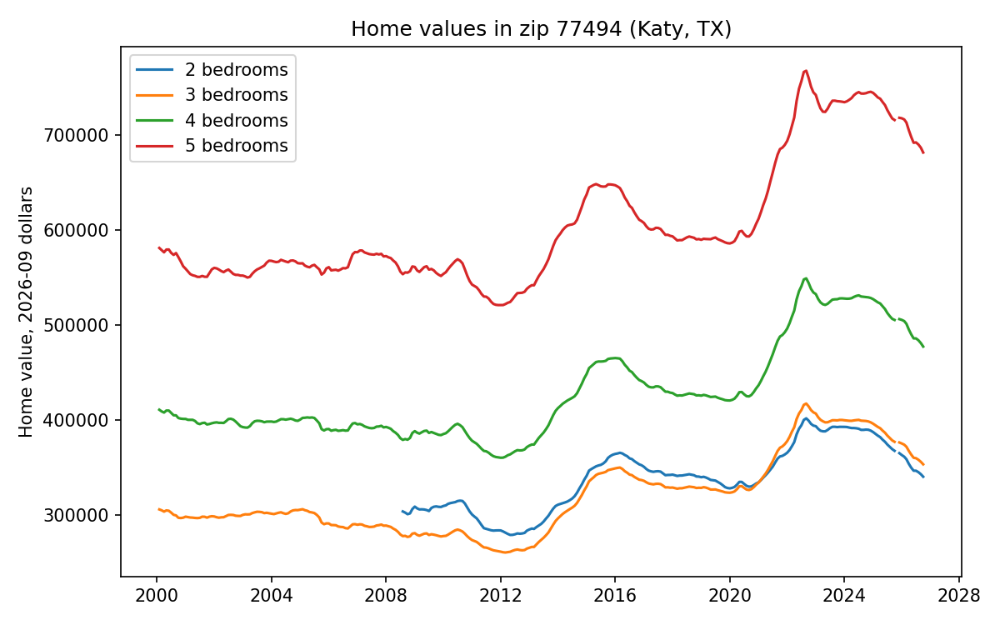

# US house prices and walkability

Joint project by Claudine Schwarzenbach and Zeynep Eyibak (2023).

We estimate how walkability, bikeability and commute times relate to house prices at the zip-code level in the US, controlling for the number of bedrooms.

## Data

- Zillow Home Value Index by zip code and bedroom count (1–5), converted to constant dollars with CPI-U (FRED, CPIAUCSL)
- Walk, Bike and Transit Scores per city, scraped from walkscore.com and matched on city and state
- Census ACS 2021 (5-year) at ZCTA level from the Census API: householder characteristics (S2502) and travel time to work (B08303)

## Pipeline (Snakemake)

1. `Data_Download.py`: downloads and scrapes the raw data
2. `Data_Preparation.py`: cleans the data and merges it into one file at the zip code × bedroom level
3. `Data_Exploration.py`: descriptive plots
4. `Analysis.py`: log home value on Walk and Bike Scores, commute shares and neighbourhood characteristics, with bedroom and state fixed effects; standard errors clustered by city
5. `Output/Output.tex`: compiles the tables and figures into a report

## Results

One observation per zip code and number of bedrooms, September 2026 (26,022 observations in 2,174 cities with a Walk Score). Dependent variable: log home value. All models control for Bike Score and number of bedrooms. Standard errors clustered by city.

| | Walk Score coefficient | 10 more points ≈ |
|---|---|---|
| Bedroom fixed effects | 0.0092 (0.0024) | +9.6% |
| + state fixed effects | 0.0046 (0.0018) | +4.7% |
| + state FE, commute times, education and age of householders | 0.0074 (0.0010) | +7.7% |

Homes in more walkable cities are worth more, also when comparing cities within the same state with similar commute times and residents. Comparing within states alone halves the estimate. These are associations, not causal effects: Walk Score is measured at the city level and is correlated with other city amenities.




Full tables are in the report (`Output.pdf`, built by the pipeline).

## Run

```
pip install -r requirements.txt
snakemake --cores 1
```

The two ACS tables are included in `Data/census`. To download them from the Census API instead, set a free key first (https://api.census.gov/data/key_signup.html): `export CENSUS_API_KEY=your_key`.

The Zillow download URL changes from time to time. If the download fails, update it in `Data_Download.py`.
