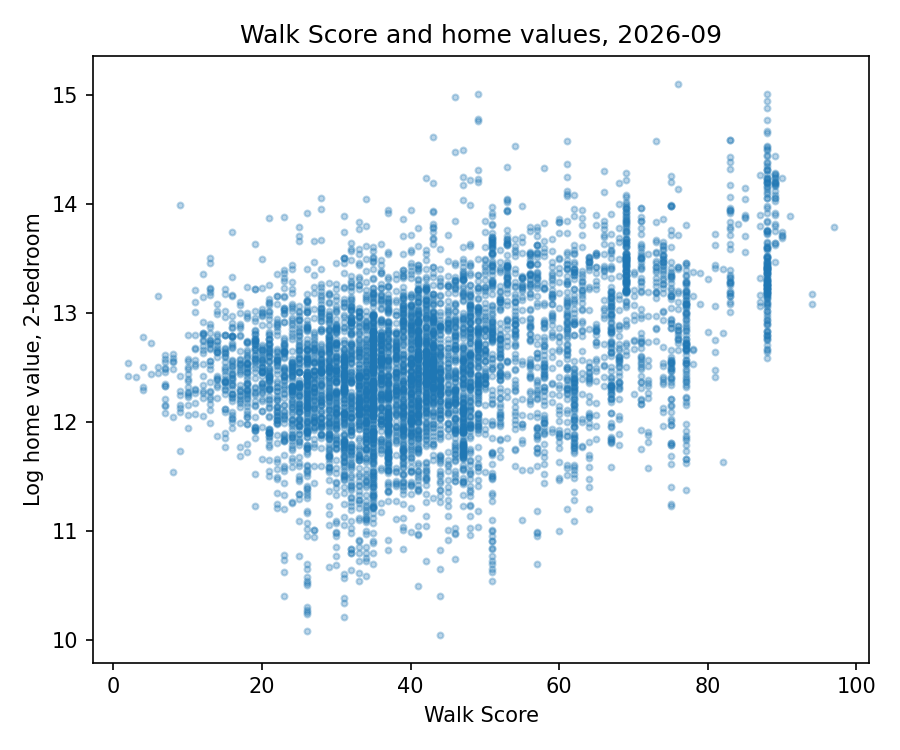
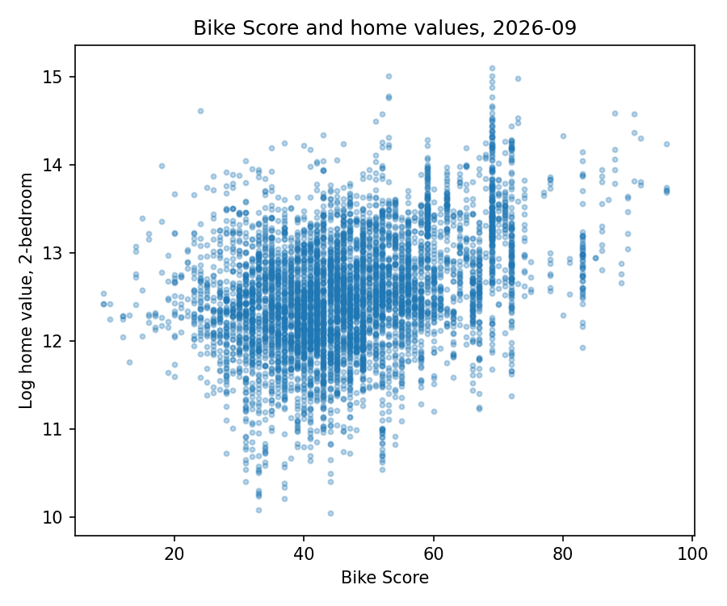

# US house prices and walkability

Joint project by Claudine Schwarzenbach and Zeynep Eyibak (2023).

We estimate how walkability, bikeability and commute times relate to house prices at the zip-code level in the US, controlling for the number of bedrooms.

The walkability data comes from a **web scraper we built for walkscore.com**: it collects the Walk, Bike and Transit Scores of every city listed for all 50 US states. We link these scores to Zillow house prices and Census data that the pipeline downloads through public files and the Census API.

## Data collection

The pipeline collects all data online from four sources (`Data_Download.py`), so the analysis can be rerun from scratch:

| Source | What | How it is collected |
|---|---|---|
| walkscore.com | Walk, Bike and Transit Scores per city | **Web scraping:** the script requests the page of each of the 50 states and parses the city tables from the HTML |
| Zillow Research | Home Value Index by zip code, one file per bedroom count (1–5) | Download of the public CSV files |
| FRED | Consumer price index (CPI-U, CPIAUCSL), to convert prices to constant dollars | Download of the CSV series |
| U.S. Census Bureau | ACS 2021 (5-year) at zip code (ZCTA) level: householder characteristics (S2502) and travel time to work (B08303) | Census API (copies of both tables are in `Data/census` for running without an API key) |

### Web scraping: walkscore.com

`download_walkscore()` in `Data_Download.py`:

1. Loops over all 50 states and requests each state's page on walkscore.com (`https://www.walkscore.com/{state}`) with `requests`, sending a browser user agent.
2. Parses every HTML table on the page with `pandas.read_html` and keeps the city tables, identified by their `City` and `Walk Score` columns.
3. Adds the state to each city row and stacks the 50 states into one table of Walk, Bike and Transit Scores (`Data/raw/Walk.csv`).

Because city names repeat across states, the scraped scores are merged to the house price data on city and state, not on city alone.

### Merging

`Data_Preparation.py` then merges the sources into one file at the zip code × bedroom level: Walk Scores on city and state (city names alone are not unique), and the Census data on the 5-digit zip code.

## Pipeline (Snakemake)

1. `Data_Download.py`: downloads and scrapes the raw data
2. `Data_Preparation.py`: cleans the data and merges it into one file at the zip code × bedroom level
3. `Data_Exploration.py`: descriptive plots
4. `Analysis.py`: log home value on Walk and Bike Scores, commute shares and neighbourhood characteristics, with bedroom and state fixed effects; standard errors clustered by city
5. `Output/Output.tex`: compiles the tables and figures into a report

## Results

One observation per zip code and number of bedrooms, September 2026 (26,022 observations in 2,174 cities with a Walk Score). Dependent variable: log home value. All models control for Bike Score and number of bedrooms. Standard errors clustered by city.

| | Walk Score coefficient | 10 more points ≈ |
|---|---|---|
| Bedroom fixed effects | 0.0092 (0.0024) | +9.6% |
| + state fixed effects | 0.0046 (0.0018) | +4.7% |
| + state FE, commute times, education and age of householders | 0.0074 (0.0010) | +7.7% |

Homes in more walkable cities are worth more, also when comparing cities within the same state with similar commute times and residents. Comparing within states alone halves the estimate. These are associations, not causal effects: Walk Score is measured at the city level and is correlated with other city amenities.





Full tables are in the report (`Output.pdf`, built by the pipeline).

## Run

```
pip install -r requirements.txt
snakemake --cores 1
```

The two ACS tables are included in `Data/census`. To download them from the Census API instead, set a free key first (https://api.census.gov/data/key_signup.html): `export CENSUS_API_KEY=your_key`.

The Zillow download URL changes from time to time. If the download fails, update it in `Data_Download.py`.
